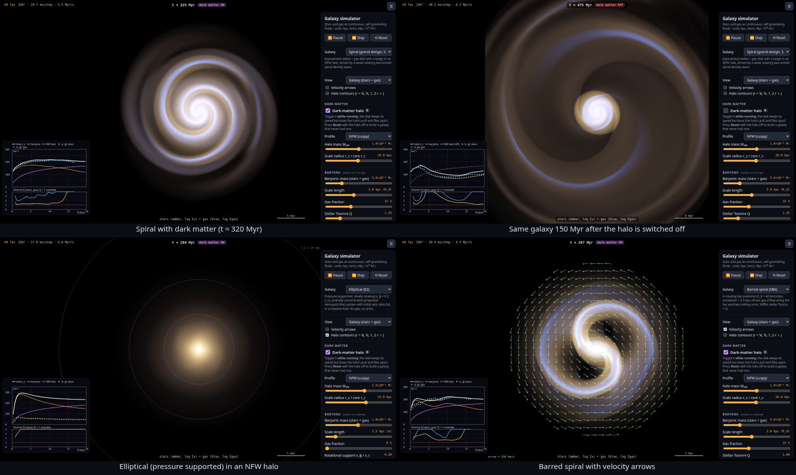
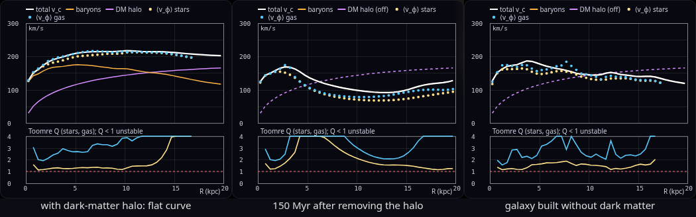

# Galaxy simulator: continuum model, with and without dark matter

An interactive, browser-based simulator of **disk (spiral, barred, lenticular)
and elliptical galaxies**, with stars and gas modelled as **continuous,
self-gravitating fluids**. The fluid equations are the compressible Euler
equations, coupled to gravity through the Poisson equation. A **dark-matter
halo** can be switched on and off while the simulation runs, and a live
**rotation curve** shows why flat rotation curves need dark matter.

**Try it live: <https://csviragh.github.io/galaxy-sim/>**



Built with **Vite + TypeScript** and no UI framework, the same setup as its
sibling [navier-stokes-sim](https://github.com/csviragh/navier-stokes-sim).
The physics is a DOM-free module in `src/solver/` with unit tests. It runs in
a Web Worker, so the page stays responsive while the solver works.

## What you can do

- **Pick a galaxy:** grand-design spiral (Sb), flocculent spiral (Sc), barred
  spiral (SBb), lenticular (S0), or elliptical (E2). The "normal" galaxies in
  the original request are the **ellipticals** and **lenticulars**:
  pressure-supported or hot systems without spiral arms.
- **Toggle dark matter live** with the checkbox or the `D` key. A disk set up in
  equilibrium *with* a halo is suddenly rotating too fast for the gravity that
  remains, so the outer disk unbinds and flies apart. Press **Reset** with the
  halo off to build a galaxy that never had one. It is self-consistent, with a
  falling rotation curve, and its heavy disk forms a strong two-armed or bar
  instability.
- **Halo profile:** NFW (cuspy) or pseudo-isothermal (cored), with an adjustable
  mass M₂₀₀ and scale radius r_s or core radius r_c.
- **Baryons:** total mass, gas fraction, scale length, stellar Toomre Q (disks),
  rotational support and ellipticity (ellipticals), the stellar equation-of-state
  index γ, and a static Hernquist bulge.
- **Driving:** an optional rigidly rotating two-armed logarithmic spiral density
  wave or bar potential, with adjustable strength, pattern speed, and pitch
  angle. The corotation circle is drawn on the canvas.
- **Views:** galaxy (stars in amber plus gas in blue, log surface density),
  stellar Σ, gas Σ, total gravitational potential Φ, vorticity, and dark-matter
  density. Overlays show velocity arrows, halo iso-density circles, the
  corotation radius, and a 5 kpc scale bar.
- **Diagnostics:** a live rotation curve plots total v_c, baryons, and the DM
  halo, plus the measured mean azimuthal velocity of stars and gas. A Toomre Q(R)
  profile, fluid mass, mass lost through the edges, kinetic and potential
  energy, angular momentum L_z, simulated time in Myr, FPS, and ms per step are
  shown alongside.
- **Units:** kpc, km/s, Myr, and 10¹⁰ M☉ throughout. In these units
  G = 4.30 × 10⁴ kpc (km/s)² / 10¹⁰ M☉, and one code time unit is
  1 kpc/(km/s) = 977.8 Myr.



## The equations

Each baryonic component (stars, gas) is a 2D fluid in the galactic plane with
surface density Σ(x, y, t) and velocity **v** = (u, v):

```
∂Σ/∂t + ∇·(Σ v) = 0                                   (continuity)
∂(Σv)/∂t + ∇·(Σ v v + P I) = −Σ ∇Φ                    (Euler momentum)
∂(ΣK)/∂t + ∇·(ΣK v) = 0,   P = K Σ^γ                  (adiabat carried with the flow)
```

- **Stars:** P ≈ Σσ² stands in for the stellar velocity dispersion σ. The
  default is γ = 1, which is locally isothermal: every parcel keeps its own σ.
  Ellipticals (and the barred preset) use γ = 2, the adiabatic index of a gas
  with two degrees of freedom. This keeps a pressure-supported profile
  convectively stable and stiffens the disk's response to the bar.
- **Gas:** isothermal with c_s = 10 km/s.

Gravity includes every mass component:

```
∇²Φ = 4πG (ρ_stars + ρ_gas + ρ_bulge + ρ_DM)           (Poisson)
Φ = Φ_disk + Φ_bulge + Φ_halo [+ Φ_bar/spiral(t)]
```

- **Disk self-gravity** treats the fluid as a thin sheet in 3D space. Its
  in-plane potential is
  `Φ_disk(x) = −G ∫ Σ(x′) / sqrt(|x − x′|² + ε²) d²x′`, with Plummer softening
  ε = 0.3 kpc standing in for the disk thickness. This is real 3D gravity, not
  2D logarithmic gravity.
- **Dark-matter halo**, static and spherical:
  - NFW: `ρ = ρ_s / [(r/r_s)(1 + r/r_s)²]`
  - pseudo-isothermal (cored): `ρ = ρ₀ / [1 + (r/r_c)²]`

  Both are normalised so that M(< r₂₀₀) = M₂₀₀, where r₂₀₀ encloses a mean
  density of 200 ρ_crit (H₀ = 70 km/s/Mpc). M₂₀₀ = 10¹² M☉ gives r₂₀₀ ≈ 206 kpc.
- **Bulge:** a static Hernquist sphere, `M(<r) = M r² / (r + a)²`.
- **Driving (optional):**
  - spiral: `Φ = −A(R) cos(m(φ − Ω_p t) + m cot(i) ln R)`
  - bar: `Φ = −A(R) cos(2(φ − Ω_b t))`

  Both ramp up over 150 Myr. The strength slider sets the peak ratio of
  non-axisymmetric to axisymmetric force.

**Why flat rotation curves imply dark matter.** A circular orbit needs
v_c²(R) = R ∂Φ/∂R ≈ G M(<R)/R. Starlight is concentrated within a few scale
lengths, so the visible mass alone predicts a Keplerian decline, v_c ∝ R^−½,
at large radii (the orange curve in the chart). Observed curves stay flat out to
tens of kpc, so M(<R) must keep growing ∝ R. That requires an unseen halo with
ρ ∝ r⁻² (the violet curve). In the simulator, the white total curve with the
halo stays flat from about 5 to 20 kpc (v(18 kpc)/v(7 kpc) > 0.9; there is a
unit test for this). Without the halo it falls to about 70% of its peak.

**Spiral arms and Toomre Q.** A disk is locally stable when
`Q = c κ / (π G Σ) > 1`, where κ is the epicyclic frequency, computed here from
the rotation curve. At Q ≈ 1–1.5, self-gravity swing-amplifies noise into
trailing arms (the flocculent preset). An imposed rotating spiral or bar drives a
grand-design pattern, with gas shocks along the arms. Hot disks (Q ≳ 2) stay
smooth (the S0 preset).

## Numerical methods

| Part | Method |
|---|---|
| Hydrodynamics | Unsplit **MUSCL–Hancock** finite volume, second order in space and time. Primitive-variable van Leer–limited slopes, a half-step predictor (including ½Δt g), and an **HLL** Riemann solver. Transverse momentum and the adiabat are upwinded with the HLL mass flux, an HLLC-like fix that keeps the shear of differential rotation sharp. Conservative update with a gravity source term Δt Σ^{n+½} g. |
| Time step | CFL: Δt = C Δx / max(\|u\| + \|v\| + 2c), default C = 0.45. That gives about 0.18 Myr at 256² in the spiral preset, capped at 2 Myr. |
| Poisson | **Hockney–Eastwood zero-padded FFT convolution** (isolated boundaries, no periodic images) with the softened sheet Green's function. Real-to-complex tricks pack two real rows into one complex FFT and transform only the non-redundant half-spectrum. It matches direct O(N⁴) summation to 10⁻¹⁰, and runs every 2 steps by default (adjustable). |
| Halo, bulge, and driving | Analytic potentials and accelerations, precomputed on the grid. Time-dependent forcing reduces to two basis fields × cos/sin(mΩt). |
| Grid | Uniform, default **256 × 256** over 40 × 40 kpc (Δx = 0.156 kpc), with 128, 192, and 384 also available. |
| Boundaries | **Outflow** (zero-gradient ghost cells with inflow suppressed). Mass that leaves is tallied as "lost at edges". |
| Floors | Density floor (10⁻⁸ of code units) on a tenuous rotating background atmosphere. **Jeans pressure floor** c² ≥ 3 G Σ Δx keeps the 2D Jeans length above 3 cells, preventing artificial grid-scale fragmentation (Truelove et al. 1997). Velocity cap of 2000 km/s for robustness. |
| Initial conditions | Density profiles (exponential disks, a projected-Hernquist-like cusp for ellipticals, plus seeded large-scale noise). The self-gravity of that density is solved first and azimuthally averaged, then combined with the analytic halo and bulge into g(R). **Disks:** σ(R) is set from the target Toomre Q (with a 10 km/s floor), and v_φ² = R g + (R/Σ) dP/dR (asymmetric drift). **Ellipticals:** v_φ = λ v_c, and pressure comes from integrating hydrostatic equilibrium, dP/dR = −Σ (1 − λ²) g, inward. **Gas:** v_φ² = R g + c_s² d ln Σ/d ln R. |

## Approximations and limitations (read this)

- **Stars are not a fluid.** Stars are collisionless, while a fluid has
  isotropic pressure, shocks, and dissipation. A pressure-supported fluid is a
  reasonable stand-in for a stellar disk's velocity dispersion on large scales
  (Toomre's fluid Q criterion, density-wave response), but it over-reacts to
  strong driving. In the **barred** preset, the stellar fluid shocks and loses
  angular momentum like gas, and the outer disk becomes strongly disturbed
  after roughly 400 Myr. Real stellar bars evolve more gently.
- **2D only.** This is a razor-thin face-on disk with softened 3D gravity. There
  is no vertical structure, warps, or bending modes. Ellipticals are modelled as
  a hot, pressure-supported sheet. That is a 2D cartoon of a 3D triaxial
  system, not a projection of one.
- **Ellipticity is not an equilibrium.** An isotropic-pressure fluid can only be
  flattened by rotation, while real ellipticals are flattened by anisotropic
  velocity dispersion. So the initial E2 shape oscillates and slowly rounds up.
- **Static, rigid halo and bulge.** There is no dynamical friction, halo
  response, or adiabatic contraction. Switching the halo off is an instantaneous
  thought experiment, not a physical process.
- **No star formation, cooling, feedback, or magnetic fields.** The adiabat K is
  only advected, so there is no shock heating. Gas is strictly isothermal. Very
  cold, gas-rich disks (Q ≲ 1.1) fragment into clumps after a few hundred Myr.
  The Jeans floor limits this to resolved scales but does not remove it.
- **Box size.** The 40 kpc box with outflow boundaries is fine for disks out to
  about 15 kpc. A disk that flies apart after its halo is removed leaves through
  the edges. The tally of mass lost at the edges records how much.
- **Second-order numerical diffusion.** The scheme is shock-capturing but
  diffusive at the grid scale, especially in the subsonic central region. Over
  thousands of steps, angular momentum transport by numerical viscosity is
  small but nonzero. A 300-step equilibrium disk conserves L_z to better than 3%
  (tested).

## Performance

The solver runs in one Web Worker, separate from the 60 fps rendering thread.
At the default 256² grid, a step costs one MUSCL–Hancock update per fluid plus
a 512² padded FFT Poisson solve every 2 steps.

Measured in headless Chrome on a shared cloud VM (virtualised Xeon; the solver
is single-threaded, so a recent desktop CPU should be noticeably faster):

| Scenario (256² grid) | Solver cost | Simulated speed | UI |
|---|---|---|---|
| Spiral (stars + gas) | 28–30 ms/step | 5.5–6.3 Myr/s | 60 fps |
| Barred spiral | 28 ms/step | 4.3 Myr/s | 60 fps |
| Elliptical (one fluid) | 18 ms/step | 4.8 Myr/s | 60 fps |

In Node at 256², one Poisson solve takes about 12 ms and one hydro update about
10 ms per fluid. At 128² a step costs about 8 ms and the time step doubles,
giving about 45 Myr/s.

Use the 128² grid for roughly 7–8× the simulated Myr per second.

## Getting started

Requires Node.js ≥ 20.19 (CI uses Node 22).

```bash
npm install
npm run dev       # dev server (http://localhost:5173)
npm test          # Vitest unit tests for the solver
npm run build     # type-check and build static files into dist/
npm run preview   # serve the production build locally
```

Screenshots and a headless smoke test use `scripts/screenshots.mjs`. It runs
each scenario, then fails if there are console errors, NaNs, or a blank canvas:

```bash
npm run build && npx vite preview --port 4173 &
npm i --no-save playwright-core
CHROME=/usr/bin/google-chrome node scripts/screenshots.mjs http://localhost:4173/
```

## Project structure

```
src/
  solver/              # pure numerics, no DOM: unit-testable and portable
    units.ts           #   galactic code units (kpc, km/s, 1e10 M☉), G, ρ_crit
    fft.ts             #   radix-2 complex FFT
    poisson.ts         #   zero-padded FFT convolution for the sheet potential
    profiles.ts        #   NFW / pseudo-isothermal halo, Hernquist bulge
    forcing.ts         #   rotating spiral / bar potentials
    hydro.ts           #   MUSCL–Hancock + HLL finite-volume Euler solver
    galaxy.ts          #   GalaxySim: two fluids + gravity, equilibrium ICs,
                       #   time stepping, fields, diagnostics
  worker/
    sim.worker.ts      # runs GalaxySim off the UI thread
    protocol.ts        # UI ↔ worker messages
  render/
    colormaps.ts       # starlight / gas / dark-matter / viridis / diverging LUTs
    renderer.ts        # Canvas2D field rendering + overlays
    chart.ts           # rotation curve + Toomre Q chart (hand-drawn, no library)
  ui/
    settings.ts        # settings = GalaxyParams + view prefs
    controls.ts        # control panel (generated sliders) + keyboard shortcuts
  presets.ts           # Spiral / Flocculent / Barred / S0 / Elliptical
  main.ts              # wiring + animation loop
tests/                 # Vitest
scripts/screenshots.mjs
docs/                  # screenshots
.github/workflows/
  ci.yml               # tests + build on push / PR
  deploy-pages.yml     # build + deploy to GitHub Pages on push to main
```

You can use the solver directly in Node or tests:

```ts
import { GalaxySim } from './src/solver';

const sim = new GalaxySim({ n: 128, darkMatter: true, forcing: 'spiral' });
while (sim.timeMyr < 300) sim.step();
const p = sim.profiles();           // rotation curve components, Q(R), …
sim.setParams({ darkMatter: false }); // remove the halo, live
```

## Tests

The `tests/` folder (`npm test`) checks that:

- **Poisson:** the FFT convolution equals O(N⁴) direct summation to 10⁻¹⁰ on
  even and odd grids. It also reproduces the analytic potential and field of a
  **Kuzmin disk** (with softening, Φ = −GM/sqrt(R² + (a + ε)²)) to within 3%.
- **Hydro:** mass is conserved to round-off with periodic and reflecting
  boundaries, momentum is conserved with periodic boundaries, a uniform state
  stays exactly static, and an acoustic pulse travels at the sound speed.
- **Profiles:** NFW and pseudo-isothermal circular velocities match their
  analytic formulas, M(<r₂₀₀) = M₂₀₀, r₂₀₀ encloses 200 ρ_crit,
  dΦ/dr = GM(<r)/r², and the densities integrate to the enclosed masses.
- **Equilibria:** a non-rotating elliptical stays static for 300 steps (rms
  velocity < 25 km/s, size within 5%). A rotating disk keeps its size, L_z,
  and v_φ(8 kpc) within 3–5%. The initial disk has the requested Toomre Q.
- **Robustness:** there are no NaNs after 800 steps of a cold, spiral-driven
  disk followed by 400 steps without its halo, or with bar driving and γ = 1.5.
- **Dark matter:** the rotation curve with a halo is flat (v(18)/v(7) > 0.9)
  and without one it falls (< 0.8). Removing the halo from an equilibrium disk
  makes it expand by more than 15% within 150 Myr.

## Deploying

`.github/workflows/deploy-pages.yml` builds and publishes `dist/` to GitHub
Pages on every push to `main`, and can also be run manually. Vite uses
`base: './'`, so the build works under `https://csviragh.github.io/galaxy-sim/`.

## Ideas for next steps

- **GPU solver** (WebGPU compute) for 512²–1024² grids at interactive speed.
- **Collisionless stars:** replace the stellar fluid with N-body particles or a
  moment-closure (anisotropic pressure tensor) model. Keep the gas as a fluid.
- A **live halo** (particles or a responsive fluid) to show dynamical friction
  and halo–bar angular-momentum exchange.
- **Star formation and feedback:** turn dense gas into stars, inject energy, and
  colour young stars blue.
- Gas cooling and heating with a real energy equation, and shock heating.
- Polar or nested grids for better resolution in the centre, and a larger box.
- **Galaxy interactions:** a satellite or flyby that tidally triggers spiral
  arms, or mergers that turn disks into ellipticals.
- **Observables:** mock line-of-sight velocity fields and position–velocity
  diagrams at a chosen inclination, compared against real HI rotation curves
  (for example, SPARC).
